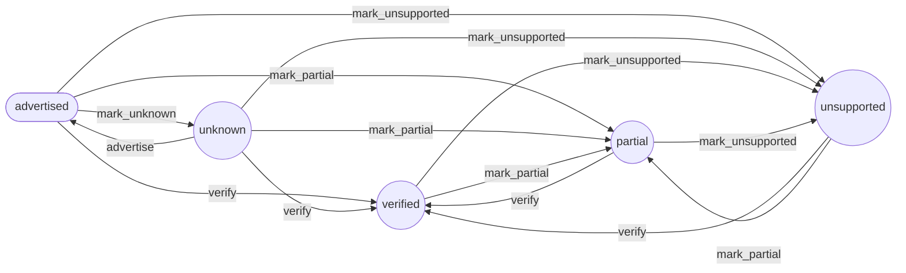
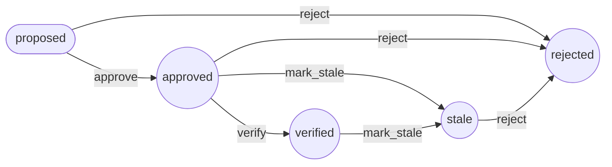

# Model-driven monitoring workflows

Two Symfony state machines in `config/packages/workflow.yaml` state the
lifecycles of capabilities and metric bindings. They mirror rules the domain
already enforces; `tests/Symfony/ModelDrivenWorkflowTest.php` compares them with
the domain for every pair of states and with these diagrams. Regenerate a
diagram with `bin/console workflow:dump <name> --dump-format=mermaid` and run
the test.

## Capability

Changes a rediscovery stores (`DiscoverDeviceCapabilities`). A verified,
partial or unsupported outcome is read from the device's model and is replaced
only by another such outcome, so nothing returns to advertised or unknown once a
model has been read. [ADR 0001](adr/0001-model-driven-monitoring.md) names the
five states and the first step from advertised; the other moves are what the
merge in `DiscoverDeviceCapabilities` stores today.

## Metric binding

The moves `BindingStatus::canMoveTo` allows, per
[ADR 0008](adr/0008-data-source-ownership-and-bindings.md). `approve` is guarded:
the guard asks IdentityAccess for the signed-in actor and the binding-approval
permission, denies by default, and audits every decision. A binding is stored
only after the guard allows the move; the stored status is the domain's, not the
workflow's.

